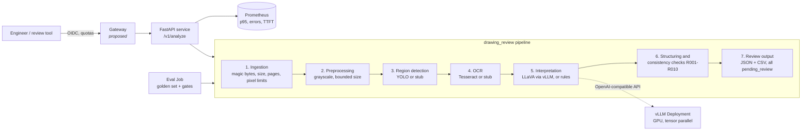

# Drawing Review Service


A local drawing-analysis prototype is hard to share, score, or prepare for a cluster. This repo rebuilds that shape as a public microservice: **detect → OCR → vision–language model → rule checks → human review**.

No company or customer code, models, or drawings — reference images are synthetic (`drawing-review golden`). Default backends are CPU stubs so the API, tests, eval, and manifests run on a laptop. YOLO, Tesseract, or a LLaVA model on vLLM / KServe is a configuration change.

**Start here:** [`docs/DEMO.md`](docs/DEMO.md) — then `make test` → `make eval` → `make validate`, and the Kind / digest evidence under `docs/`.

Built with FastAPI, Docker, Kubernetes / OpenShift overlays, KServe, and Prometheus. Proven on this laptop and Kind: 57 CPU tests, golden gates, Ready 1/1 + rollback, GHCR digest in [`docs/image-digests.md`](docs/image-digests.md). Not claimed: live GPU OpenShift apply, or TTFT against a real InferenceService.

[What’s here](#whats-here) · [Architecture](#architecture) · [Evaluation](#why-evaluation-is-split-in-two) · [Run](#run) · [Status](#status)

## What’s here

| Area | Artefact |
|:--|:--|
| Service | FastAPI, pydantic schemas, structured 413 / 415 / 422 / 503, health ≠ readiness |
| Packaging | Multi-stage non-root image (UID 10001), read-only root |
| Cluster | kustomize overlays, NetworkPolicy, OpenShift Route / SCC notes |
| Inference prep | KServe `ServingRuntime` + `InferenceService` (RawDeployment); standalone vLLM Deployment |
| Quality | Golden set, extraction vs business gates, per-run lineage |
| Ops | Pending-first [runbook](docs/runbook.md), [observability](docs/observability.md), HPA stub ([autoscaling](docs/autoscaling.md) — unmeasured) |
| Governance | Model / data cards, risk register, AI Act–style checklist ([mapping](docs/ai-act-mapping.md)), digest ≠ signature ≠ approval ([checklist](checklists/release-approval.md)) — engineering artefacts, not a conformity claim |

## Architecture



| Module | Responsibility |
|---|---|
| `schemas.py` | data contract (pydantic), versioned |
| `config.py` | `DRW_*` env vars, validated at startup |
| `ingest.py`, `preprocess.py` | input validation and normalisation |
| `backends/` | detector / OCR / interpreter protocols; stub + real |
| `parsing.py`, `checks.py` | text → fields; review rules |
| `pipeline.py` | orchestration and per-stage timing |
| `api.py` | HTTP, errors, health, metrics |
| `evaluation/` | harness, metrics, release gates |
| `lineage.py` | code / model / data / config versions per run |

## Why evaluation is split in two

Recognising a symbol is not the same as the drawing being correct.

- **Extraction** — detection P/R at IoU 0.5, OCR CER, field accuracy.
- **Business correctness** — did the review raise the defects that were there, and stay quiet on clean drawings?

The synthetic generator seeds known defects independently of the rules code. Stub backends can inject noise. On 12 drawings with 3% CER, 5% drop rate, 4 px jitter:

| | clean stubs | noisy stubs |
|---|---|---|
| detection recall | 1.00 | 0.94 |
| OCR character error rate | 0.000 | 0.023 |
| defect recall (business) | 1.00 | 0.83 |
| false alarms on clean drawings | 0.00 | 0.75 |
| release gate | pass | **fail** |

These numbers describe the **harness on synthetic data**, not any model. Extraction can look fine while business gates fail — a misread datum letter turns a clean drawing into a false alarm.

```bash
drawing-review eval --data golden
DRW_STUB_CHAR_ERROR_RATE=0.03 DRW_STUB_DROP_RATE=0.05 DRW_STUB_JITTER_PX=4 \
  drawing-review eval --data golden
```

## Run

```bash
python -m venv .venv && . .venv/bin/activate
make install
make test             # 57 tests, CPU
make eval
drawing-review golden
uvicorn --factory drawing_review.api:app_factory --port 8080
curl -F file=@golden/images/syn-001.png localhost:8080/v1/analyze
```

Docker / Kind:

```bash
make image
docker run --rm -p 8080:8080 --read-only --tmpfs /tmp drawing-review:dev

make kind-up && make deploy-kind
kubectl -n drawing-review port-forward svc/drawing-review 8080:80
make validate         # kustomize + kubeconform, no cluster needed
```

Real models need a GPU node, the NVIDIA device plugin, and weights on `model-weights`. OpenShift AI path: [`docs/kserve.md`](docs/kserve.md) — schema-validated, **not** applied live here.

## Status

**Tested in this repo:** pipeline, API, stubs, rules, eval gates, lineage, metrics, Docker image, kustomize manifests, Kind Ready + eval Job Complete ([evidence](docs/evidence/kind-apply/)), CI on `main` (lint, tests, eval, manifests, image smoke, GHCR push).

**Written, not exercised on a shared GPU project:** YOLO / Tesseract / LLaVA backends (no public weights), GPU overlay, vLLM Deployment, OpenShift AI InferenceService apply.

**Next door:** DDP train loop in [lora-finetune-recipe](https://github.com/lyftium/lora-finetune-recipe) (this repo holds the `PyTorchJob` YAML); gateway + agent in [agent-gateway-stack](https://github.com/lyftium/agent-gateway-stack); measured serving levers in [vllm-serving-benchmark-t4](https://github.com/lyftium/vllm-serving-benchmark-t4). Gateway design notes: [`docs/gateway.md`](docs/gateway.md).

MIT · [laptop smoke](docs/evidence/laptop-smoke-2026-11-04.md) · [Kind smoke](docs/evidence/kind-smoke-2026-11-04.md) · [digests](docs/image-digests.md)
