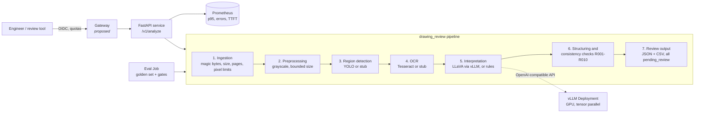

# Drawing review service


A drawing-review pipeline that only runs on one laptop is hard to hand to someone else. I turned that shape into a FastAPI service: typed requests and errors, a golden-set check, and a container that runs as a non-root user.

CPU stubs stand in for detection, OCR, and the vision-language model, so `make test` and `make eval` do not download weights. I applied the Kubernetes manifests on a local Kind cluster and recorded a rollback.

Synthetic drawings only — no customer files. Walkthrough: [`docs/DEMO.md`](docs/DEMO.md). Image digest notes: [`docs/image-digests.md`](docs/image-digests.md).

[What’s in the repo](#whats-in-the-repo) · [Architecture](#architecture) · [Evaluation](#why-evaluation-is-split-in-two) · [Run](#run) · [Status](#status)

## What’s in the repo

When backends are wired the path is detect → OCR → VLM → rules → human review. Stubs keep that path testable without weights.

| | |
|:--|:--|
| Service | FastAPI, pydantic schemas, structured errors, health ≠ readiness |
| Image | Multi-stage, non-root (UID 10001), read-only root |
| Cluster prep | kustomize, NetworkPolicy, OpenShift Route / SCC notes, KServe `ServingRuntime` + `InferenceService` |
| Quality | Golden set, extraction vs business gates, per-run lineage |
| Ops notes | Pending-first [runbook](docs/runbook.md), [observability](docs/observability.md), HPA stub (unmeasured) |
| Release hygiene | Cards / risk register / internal checklist ([`docs/ai-act-mapping.md`](docs/ai-act-mapping.md) — engineering notes, not a conformity claim) · [digest ≠ approval](checklists/release-approval.md) |

## Architecture



| Module | Responsibility |
|---|---|
| `schemas.py` | data contract (pydantic), versioned |
| `config.py` | `DRW_*` env vars, validated at startup |
| `ingest.py`, `preprocess.py` | input validation and normalisation |
| `backends/` | detector / OCR / interpreter protocols; stub + real |
| `parsing.py`, `checks.py` | text → fields; review rules |
| `pipeline.py` | orchestration and per-stage timing |
| `api.py` | HTTP, errors, health, metrics |
| `evaluation/` | harness, metrics, release gates |
| `lineage.py` | code / model / data / config versions per run |

## Why evaluation is split in two

Recognising a symbol is not the same as the drawing being correct.

- **Extraction** — detection P/R at IoU 0.5, OCR CER, field accuracy.
- **Business correctness** — did the review raise the defects that were there, and stay quiet on clean drawings?

The synthetic generator seeds known defects independently of the rules code. Stub backends can inject noise. On 12 drawings with 3% CER, 5% drop rate, 4 px jitter:

| | clean stubs | noisy stubs |
|---|---|---|
| detection recall | 1.00 | 0.94 |
| OCR character error rate | 0.000 | 0.023 |
| defect recall (business) | 1.00 | 0.83 |
| false alarms on clean drawings | 0.00 | 0.75 |
| release gate | pass | **fail** |

**Stub harness only** — not detector / OCR / VLM model quality. Extraction can look fine while business gates fail (a misread datum letter turns a clean drawing into a false alarm).

```bash
drawing-review eval --data golden
DRW_STUB_CHAR_ERROR_RATE=0.03 DRW_STUB_DROP_RATE=0.05 DRW_STUB_JITTER_PX=4 \
  drawing-review eval --data golden
```

## Run

```bash
python -m venv .venv && . .venv/bin/activate
make install
make test             # 57 tests, CPU
make eval
drawing-review golden
uvicorn --factory drawing_review.api:app_factory --port 8080
curl -F file=@golden/images/syn-001.png localhost:8080/v1/analyze
```

Docker / Kind:

```bash
make image
docker run --rm -p 8080:8080 --read-only --tmpfs /tmp drawing-review:dev

make kind-up && make deploy-kind
kubectl -n drawing-review port-forward svc/drawing-review 8080:80
make validate         # kustomize + kubeconform, no cluster needed
```

Real models need a GPU node, the NVIDIA device plugin, and weights on `model-weights`. The optional model-serving manifests are in [`deploy/`](deploy/); this repository has no recorded GPU-backed deployment.

## Status

**Tested in this repo:** pipeline, API, stubs, rules, eval gates, lineage, metrics, Docker image, kustomize manifests, Kind Ready + eval Job Complete ([evidence](docs/evidence/kind-apply/)), CI on `main` (lint, tests, eval, manifests, image smoke, GHCR push).

**Written, not exercised on a shared GPU project:** YOLO / Tesseract / LLaVA backends (no public weights), GPU overlay, vLLM Deployment, OpenShift AI InferenceService apply.

**Next door:** DDP train loop in [lora-finetune-recipe](https://github.com/lyftium/lora-finetune-recipe) (this repo holds the `PyTorchJob` YAML); gateway + agent in [agent-gateway-stack](https://github.com/lyftium/agent-gateway-stack); measured serving levers in [vllm-serving-benchmark-t4](https://github.com/lyftium/vllm-serving-benchmark-t4). Gateway design notes: [`docs/gateway.md`](docs/gateway.md).

MIT · [laptop smoke](docs/evidence/laptop-smoke-2026-11-04.md) · [Kind smoke](docs/evidence/kind-smoke-2026-11-04.md) · [digests](docs/image-digests.md)
