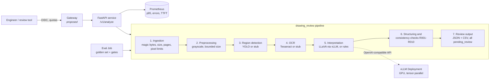

# Drawing Review Service


### From a local drawing-analysis prototype to a testable, deployable microservice

A public demonstrator of AI **integration** for engineering documents: detection →
OCR → vision–language model → rule checks → human review. Distinct from the private
prototype that inspired it. Contains **no company or customer code, models or
drawings**; reference images are synthetic and generated from a fixed seed
(`drawing-review golden`).

Backends are pluggable. Default stubs run the API, tests, evaluation and Kubernetes
manifests on a laptop with no GPU. YOLO, Tesseract or a LLaVA model on vLLM
(standalone or via KServe) is a configuration change.

| | |
|:--|:--|
| **Problem** | A drawing-review prototype that only runs locally cannot be shared, scored or prepared for a cluster. |
| **90s path** | `make install && make test` → `make eval` → `make validate` → skim [`docs/evidence/RELEASE-PACK.md`](docs/evidence/RELEASE-PACK.md) |
| **Verify** | 57 CPU tests · golden eval · kubeconform · Kind Ready evidence · GHCR digest · rollback script needs live GPU/cluster undo transcript |
| **CI** |  — workflow live under [`.github/workflows/ci.yml`](.github/workflows/ci.yml) |
| **Status & limits** | Kind **Ready 1/1** + eval Complete ([`docs/evidence/kind-apply/`](docs/evidence/kind-apply/)). GPU OpenShift **not** applied live. CI **enabled**. GHCR `sha256:77d1723b9d2a1a565ec8fa61787db5f881bf5a77156cfa7f4744b15c893b9bad` ([`docs/image-digests.md`](docs/image-digests.md)). |
| **Next** | Apply `deploy/openshift-ai` on a shared GPU project; measure TTFT against a real InferenceService. |

## At a glance

| Area | In this repo |
|:--|:--|
| Service | FastAPI, Docker, health probes, NetworkPolicy |
| Cluster | Kubernetes manifests + OpenShift overlay (Route, restricted SCC) |
| Inference | KServe `InferenceService` on a vLLM `ServingRuntime` (OpenShift AI); standalone vLLM Deployment; gateway design notes |
| Quality | Eval harness, release gates, Prometheus, run lineage |
| Observability | Service / quality / infra triad — [`docs/observability.md`](docs/observability.md) |
| Autoscaling | Honesty note + HPA stub (unmeasured) — [`docs/autoscaling.md`](docs/autoscaling.md) |
| Training | PyTorchJob YAML for Training Operator |
| Rollback | `scripts/demo_rollback.sh` + `docs/rollback.md` (needs live apply; evidence under `docs/evidence/`) |
| Governance | Model / data cards + risk register (`docs/model-card.md`, `docs/data-card.md`, `docs/risk-register.md`); AI Act–style checklist (`docs/ai-act-mapping.md`) — engineering artefacts, not a conformity claim |


## Integrator signals (what this repo is for)

Built so an integration interview can stay concrete: **contracts** (API + gates), **cluster prep** (kustomize overlays, NetworkPolicy, non-root UID 10001, OpenShift SCC notes), **Pending-first diagnosis** ([`docs/runbook.md`](docs/runbook.md)), **release identity** (commit ↔ image digest ↔ eval), and **honest limits** (stubs by default; GPU OpenShift apply not claimed).

## Architecture



Code layout follows the same split: business logic, model loading, configuration
and I/O live in separate modules, so each can change without touching the others.

| Module | Responsibility |
|---|---|
| `schemas.py` | the data contract (pydantic). Versioned; downstream tools depend on it |
| `config.py` | all runtime settings from `DRW_*` env vars, validated at startup |
| `ingest.py`, `preprocess.py` | input validation and image normalisation |
| `backends/` | detector, OCR and interpreter protocols, stub and real implementations |
| `parsing.py`, `checks.py` | business logic: from text to fields, and the review rules |
| `pipeline.py` | orchestration and per-stage timing, no HTTP and no model code |
| `api.py` | HTTP interface, error handling, health endpoints, metrics |
| `evaluation/` | harness, metrics and release gates |
| `lineage.py` | code / model / data / config versions for every run |

## Why the evaluation is split in two

Recognising a symbol correctly is not the same as the drawing being correct. The
harness scores the two separately:

- **Extraction**: detection precision/recall at IoU 0.5, OCR character error rate,
  field-level accuracy.
- **Business correctness**: per drawing, did the review raise the defects that were
  actually there, and stay quiet on clean drawings?

The synthetic generator seeds known defects (an undefined datum, a flatness
tolerance with a datum reference, an inverted tolerance band, a missing revision, a
duplicate BOM item...) and records them in the labels independently of the rules
code, so the rules engine is really tested.

The stub backends can inject seeded noise (dropped regions, jittered boxes,
character substitutions). Running the harness on the 12 synthetic drawings with a
3% character error rate, 5% dropped regions and 4 px jitter gives this:

| | clean stubs | noisy stubs |
|---|---|---|
| detection recall | 1.00 | 0.94 |
| OCR character error rate | 0.000 | 0.023 |
| defect recall (business) | 1.00 | 0.83 |
| false alarms on clean drawings | 0.00 | 0.75 |
| release gate | pass | **fail** |

These numbers describe the harness on synthetic data, **not any model**. What they
show is the point of the design: the extraction metrics look acceptable and pass
their gates, while the business metrics fail, because a single misread datum letter
turns a clean drawing into a false alarm. A global extraction score would have hidden
that. Reproduce with:

```bash
drawing-review eval --data golden
DRW_STUB_CHAR_ERROR_RATE=0.03 DRW_STUB_DROP_RATE=0.05 DRW_STUB_JITTER_PX=4 \
  drawing-review eval --data golden
```

## Industrialisation checklist

| | What | Where |
|---|---|---|
| ✅ | Reproduce the reference result before changing anything: golden set + exact-match regression test | `golden/`, `tests/test_golden.py` |
| ✅ | Business logic, model loading, config and I/O separated | `src/drawing_review/` |
| ✅ | Stable interface: pydantic schemas, structured errors (413/415/422/503) with request id | `schemas.py`, `api.py` |
| ✅ | Pluggable backends, CPU stubs so tests run without weights | `backends/` |
| ✅ | Unit + integration tests (57), lint config | `tests/` |
| 📝 | CI pipeline (lint, tests, eval gates, manifest validation, image smoke test) written, not yet enabled | `ci/github-actions-ci.yml` |
| ✅ | Evaluation harness with release gates, extraction vs business | `evaluation/` |
| ✅ | Lineage: git sha, backend versions, config hash, dataset hash per result and per run | `lineage.py` |
| ✅ | Pinned dependencies, multi-stage image, non-root user | `requirements.lock`, `Dockerfile` |
| ✅ | Kubernetes: resources, startup/readiness/liveness probes, read-only root fs, dropped capabilities, restricted Pod Security, NetworkPolicy, PDB, weights on a PVC, eval Job | `deploy/k8s/` |
| ✅ | GPU overlay (`nvidia.com/gpu` requests = limits, node selector, tolerations) | `deploy/k8s/overlays/gpu` |
| ✅ | vLLM serving example with tensor parallelism, request logging off | `deploy/k8s/vllm/` |
| ✅ | KServe: vLLM `ServingRuntime` + `InferenceService` (RawDeployment, 2 GPUs, weights from PVC), OpenShift AI overlay, validated against the KServe CRD schemas | `deploy/kserve/`, `deploy/openshift-ai/`, `docs/kserve.md` |
| ✅ | Metrics: request and stage latency histograms (p95), error counter, LLM time to first token; alert rules | `metrics.py`, `deploy/monitoring/` |
| ✅ | Load benchmark for the service and for an OpenAI-compatible LLM endpoint (TTFT, p95) | `bench/load_test.py` |
| ✅ | Logging policy: hashes, sizes and timings only, never file names or content (tested) | `api.py`, `tests/test_api.py` |
| ✅ | Runbook for "the model doesn't start" | `docs/runbook.md` |
| ✅ | OpenShift overlay: Route, SCC-friendly patch, PyTorchJob YAML | `deploy/openshift/`, `docs/openshift.md` |
| ✅ | AI Act–style engineering checklist (not a legal claim) | `docs/ai-act-mapping.md` |
| 📝 | Gateway (auth, quotas, routing, logging policy) | design only: `docs/gateway.md` |
| 📝 | Split into services | proposal: `docs/architecture.md` |

## Run it

Locally:

```bash
python -m venv .venv && . .venv/bin/activate
make install          # pinned deps + the package
make test             # 57 tests, a few seconds, CPU only
make eval             # evaluation report and gates
drawing-review golden # writes the synthetic drawings to golden/images (not in git)
uvicorn --factory drawing_review.api:app_factory --port 8080
curl -F file=@golden/images/syn-001.png localhost:8080/v1/analyze
curl -F file=@golden/images/syn-001.png localhost:8080/v1/analyze.csv
```

With Docker:

```bash
make image
docker run --rm -p 8080:8080 --read-only --tmpfs /tmp drawing-review:dev
```

On a local Kubernetes cluster (kind; minikube works the same with `minikube image load`):

```bash
make kind-up
make deploy-kind
kubectl -n drawing-review port-forward svc/drawing-review 8080:80
python bench/load_test.py service --url http://localhost:8080 -n 200 -c 8
kubectl -n drawing-review create job eval-now --from=job/drawing-review-eval
kubectl -n drawing-review logs job/eval-now
```

Validate the manifests without a cluster: `make validate` (kustomize + kubeconform).

With real models (needs a GPU node, the NVIDIA device plugin and weights on the
`model-weights` volume): `kubectl apply -k deploy/k8s/overlays/gpu` and
`kubectl apply -f deploy/k8s/vllm/`.

On OpenShift AI, the model is served by KServe instead
([`docs/kserve.md`](docs/kserve.md)):

```bash
kustomize build deploy/openshift-ai | oc apply -f -
oc -n drawing-review get inferenceservice llava
```

## Status and roadmap

I want to be precise about what is here.

**Implemented and tested in this repo**: the pipeline, the API, the stub backends,
the rules engine, the evaluation harness and gates, lineage, metrics, the benchmark
script, the Docker image, and Kubernetes manifests that build with kustomize
(`make validate` adds `kubeconform`). The CI workflow is written
(`ci/github-actions-ci.yml`: lint, tests, evaluation gates, manifest validation
including the OpenShift overlay, image build + GHCR push on `main`) and is enabled on
this repository yet.

**OpenShift overlay (implemented)**: `deploy/openshift/` adds a TLS Route, an
SCC-aware Deployment patch (fixed UIDs removed with JSON patches), a NetworkPolicy
for the router, monitoring and `openshift-dns`, KServe model serving for OpenShift AI
(`deploy/openshift-ai/`, [`docs/kserve.md`](docs/kserve.md); schema-validated, not yet
applied to a live cluster), and a `PyTorchJob` YAML for the Training
Operator CRD. Full guide: [`docs/openshift.md`](docs/openshift.md). Serving placement: [`docs/openshift-ai-serving.md`](docs/openshift-ai-serving.md). AI Act–style
engineering mapping (checklist, not a legal claim):
[`docs/ai-act-mapping.md`](docs/ai-act-mapping.md).

**Written but not exercised here**: the YOLO, Tesseract and LLaVA/vLLM backends (no
weights in a public repo), `Dockerfile.gpu`, the GPU overlay and the vLLM manifest.
They are written against the documented APIs, but I have not run these exact files
on a multi-GPU cluster.

**Distributed training:** DDP is implemented and run with `torchrun` in
[lora-finetune-recipe](https://github.com/lyftium/lora-finetune-recipe) (CPU gloo proof;
CUDA nccl). This repo carries the cluster submit YAML (`deploy/openshift/pytorchjob-ddp.yaml`).

**Still deepening on a live shared GPU cluster:**

- Live submit of the `PyTorchJob` against OpenShift AI Training Operator.
- Serving tuning from measured TTFT / p95 / GPU memory (tensor vs pipeline vs replicas).
- Gateway deployed in front of the service (design in `docs/gateway.md`).

## License

MIT

## Laptop smoke

Pytest: [`docs/evidence/laptop-smoke-2026-11-04.md`](docs/evidence/laptop-smoke-2026-11-04.md) (57 passed). Kind Ready + eval: [`docs/evidence/kind-smoke-2026-11-04.md`](docs/evidence/kind-smoke-2026-11-04.md). Digests: [`docs/image-digests.md`](docs/image-digests.md).
